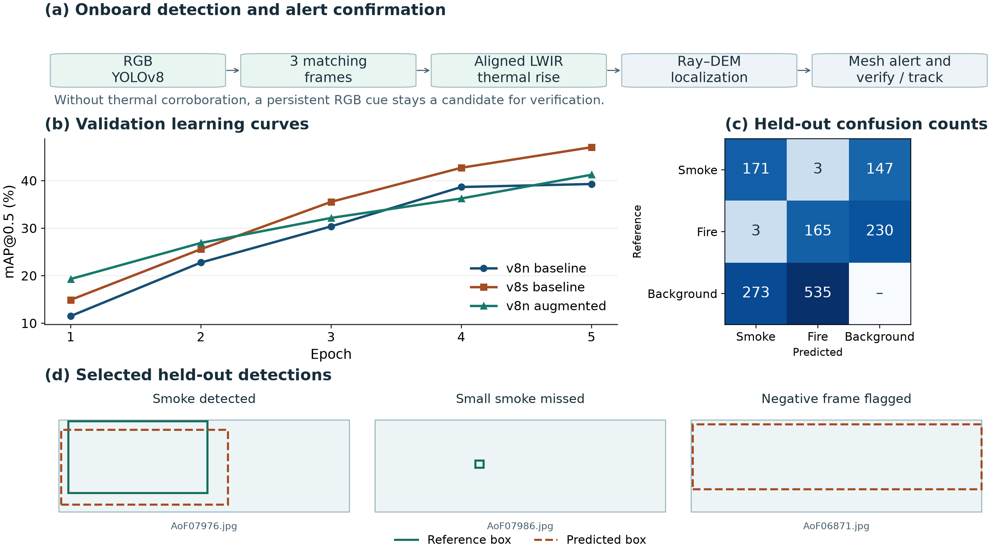

# Section 4 AI Integration

## 4.1 Role of AI in the Swarm

Each of the four UAVs runs fire and smoke detection in its onboard perception module. RGB frames provide the first indication of weak smoke or visible flame, and the registered long-wave infrared (LWIR) channel can corroborate a heat source. A confirmed observation carries the class, confidence and RGB box centre. With time-aligned camera calibration and UAV pose, Section 3's Ray–DEM module projects that observation into the shared map. Smoke can drift away from its source, so a smoke-only location is treated as a cue for another viewpoint or operator review.

In the decision layer, recent perimeter observations and measured wind can support short-horizon downwind extrapolation. The swarm can use this estimate to prioritise sectors for additional observations. The behaviour tree and APF/EGO-Swarm planner retain authority over flight paths, separation and emergency handling (Zhou et al., 2021). Multi-agent reinforcement learning, including attention-based PPO, could be evaluated in simulation for task allocation. Field use would require evidence that it generalises to unfamiliar terrain, wind and communication outages.

## 4.2 Detection and Confirmation

YOLOv8n and YOLOv8s provide two capacities of the same single-stage detector (Ultralytics, 2023). The augmented nano arm adds mosaic, scale jitter and vertical flips to improve exposure to small and differently oriented targets. At runtime, three consecutive overlapping detections of the same class establish visual persistence. The prototype compares the temperature inside a registered LWIR region with the adjacent background. A persistent RGB observation without corroborating heat stays available for verification, and a corroborated track issues one alert.

The deployment plan uses TensorRT FP16 on a Jetson Orin Nano. Acceptance requires sustained throughput above 35 RGB frames per second, single-frame processing below 30 ms, and class recall above 90%. Three-frame confirmation adds a delay that should be measured from camera capture to alert and reported separately. Thresholds are selected on validation data for recall, with the false-alarm cost recorded on background frames.

## 4.3 Limitations in Country Parks

Morning fog, low cloud and reflected sunlight can resemble thin smoke. At 70 m, early flames occupy few pixels, and dense canopy can block the RGB and LWIR views. Registration error or weak heat contrast can also prevent thermal corroboration. D-Fire combines varied viewpoints and has neither aligned thermal imagery nor a Hong Kong aerial test split. Validation needs local sequences spanning terrain, altitude, visibility and hard negatives. The board trial should also measure power draw and compare the additional load with the battery budget. Thermal filtering and board targets require synchronized sensor and hardware measurements.

## 4.4 D-Fire Benchmark Trial

We stratified 4,500 D-Fire images into 3,300 for training, 600 for validation and 600 for held-out testing (de Venâncio, Lisboa, & Barbosa, 2022). All arms started from COCO weights and used five epochs and 256 px inputs. The first comparison changes model capacity. The second changes the augmentation package while holding the nano architecture fixed. Test recall uses IoU ≥ 0.50 and a confidence threshold selected on validation.

YOLOv8s scored 5.1 percentage points higher in mAP@0.5 than baseline YOLOv8n, and the nano processed 1.69 times as many frames per second on the Ryzen CPU. At a shared confidence of 0.10, small-smoke recall fell from 21.4% to 14.6% with the augmentation package. All three arms fell short of the 90% recall target for both classes together on validation, so operating points use maximum macro F2. The comparison uses one seed. Related scenes can still occur across splits because the source lacks consistent event identifiers.

**Held-out RGB detector results**

| Model | Params | mAP50 | Smoke R | Fire R | Small R¹ | Neg.² | CPU FPS |
| --- | --- | --- | --- | --- | --- | --- | --- |
| YOLOv8n baseline | 3.01M | 39.3% | 54.5% | 45.0% | 21.4% | 17.5% | 37.7 |
| YOLOv8s baseline | 11.14M | 44.4% | 57.9% | 41.2% | 13.6% | 11.1% | 22.3 |
| YOLOv8n augmented | 3.01M | 36.7% | 53.6% | 41.7% | 14.6% | 19.3% | 42.9 |

*Note.* ¹ Small-smoke recall for boxes under 1,024 px² at model input. ² Share of negative images with an RGB prediction. CPU FPS excludes decode and thermal processing.

**Figure 3.** Edge AI fire and smoke detection pipeline and D-Fire evaluation. Panels (c) and (d) show augmented YOLOv8n at confidence 0.1. Panel (d) redraws test box coordinates as diagrams.

## References

de Venâncio, P. V. A. B., Lisboa, A. C., & Barbosa, A. V. (2022). An automatic fire detection system based on deep convolutional neural networks for low-power, resource-constrained devices. *Neural Computing and Applications, 34*, 15349–15368. doi:10.1007/s00521-022-07467-z

Ultralytics. (2023). *YOLOv8* [Computer software]. Retrieved from https://docs.ultralytics.com/models/yolov8/

Zhou, X., Zhu, J., Zhou, H., Xu, C., & Gao, F. (2021). EGO-Swarm: A fully autonomous and decentralized quadrotor swarm system in cluttered environments. In *2021 IEEE International Conference on Robotics and Automation* (pp. 4101–4107). doi:10.1109/ICRA48506.2021.9561902
